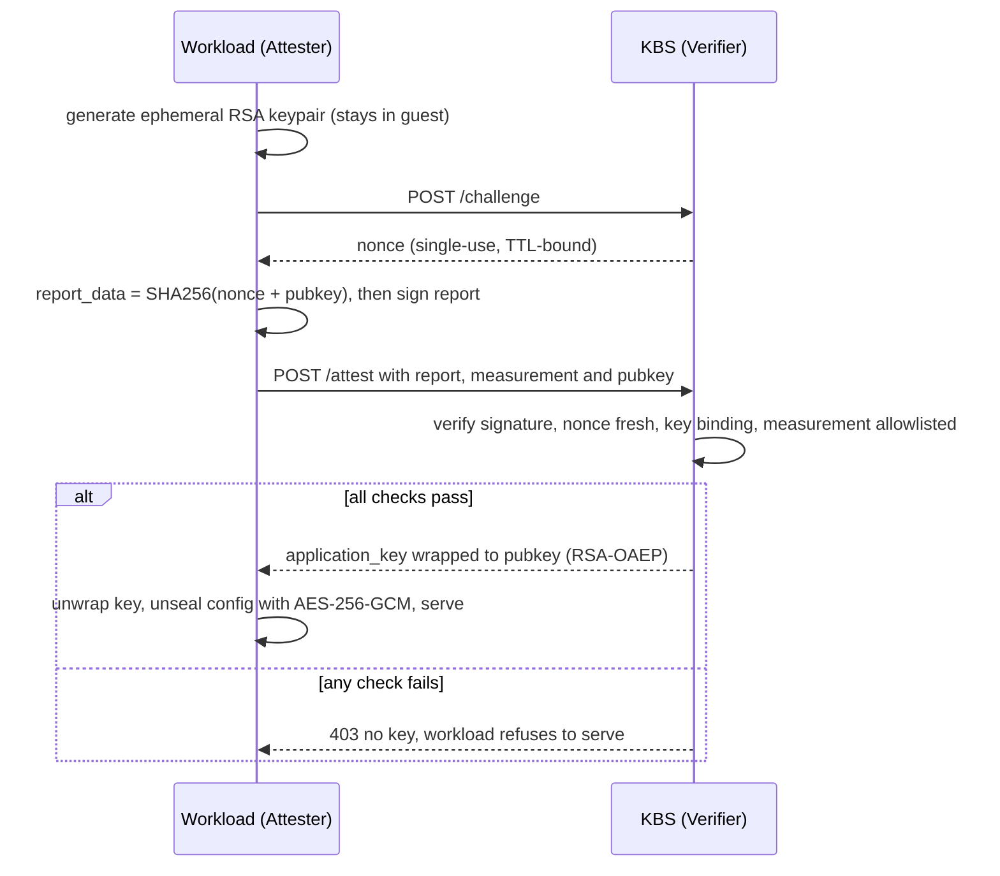
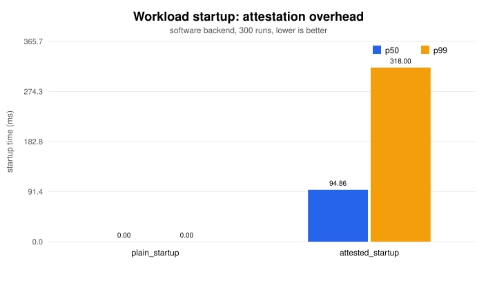

# Confidential-container PoC: attested key release

A small, finished proof of concept of the pattern at the heart of confidential
computing: **a workload only receives its secret after it proves, by remote
attestation, that it is the expected code running in a trusted environment.**

A workload boots, attests to a Key Broker Service (KBS), and receives an
application key *only if* its attestation report satisfies the KBS policy. It
then unseals its config and serves. No attestation → no key → it refuses to run.
The design follows IETF RATS ([RFC 9334](https://www.rfc-editor.org/rfc/rfc9334))
and mirrors the [Confidential Containers](https://github.com/confidential-containers) KBS flow.

> **Scope.** The attestation protocol, verification, and key release are real
> and fully exercised with a portable software backend, so this reproduces on
> any laptop with one command. The hardware backend (AMD SEV-SNP / Intel TDX) is
> a documented integration point, not a running binary, because it needs a real
> confidential VM — see [Real hardware](#real-hardware) and [Limitations](#limitations).

## Attestation + key-release flow



Each KBS check and what it buys:

| Check | Guarantees | Real-TEE analogue |
|-------|-----------|-------------------|
| Signature vs pinned anchor | Evidence came from a genuine TEE | VCEK chained to AMD root |
| Nonce issued-by-us & single-use | Freshness; defeats replay | report nonce |
| `report_data == SHA256(nonce‖pubkey)` | Released key usable only by *this* guest; defeats key substitution | 64-byte `REPORT_DATA` |
| Measurement ∈ allowlist | The *expected code* is running | `ATTESTATION_REPORT.MEASUREMENT` |

The key is wrapped to the attested public key, so the secret is never exposed in
transit and only the guest that produced the report can unwrap it.

## Quickstart

```bash
make demo                 # seal config, start KBS + workload, show success + tamper case
```

Or manually / with containers:

```bash
make run-kbs              # terminal 1
make run-workload         # terminal 2 (seals config automatically)
curl localhost:9090/config          # unsealed config (proves key release)
curl "localhost:9090/sign?msg=hi"   # HMAC with released key; key never leaves

docker compose up --build # same flow in containers (image ships only sealed config)
```

Verified end-to-end: a valid guest gets the key and serves its unsealed config;
a workload with an untrusted launch measurement
(`WORKLOAD_LAUNCH_DIGEST=tampered-image:evil`) is refused the key and exits
non-zero. Unit tests assert the same, plus tampered-signature, stale-nonce, and
key-substitution rejection.

## Benchmark

`make bench` runs the full handshake many times in-process versus a plain
no-attestation key load, measuring the attestation protocol overhead (the part
honest to measure without real TEE hardware).



From `bench/results.json` (300 runs, machine-dependent):

| Path | p50 | p99 |
|------|-----|-----|
| plain startup | ~0 ms | ~0 ms |
| attested startup | ~95 ms | ~318 ms |

Attestation adds roughly **90–100 ms of one-time startup cost**, dominated by the
guest's RSA-2048 keygen and the round trips. It is paid once at boot;
**steady-state request latency is unaffected**. This does *not* include TEE
memory-encryption CPU/RAM overhead, which is a hardware property (see below).

## Real hardware

Target: a cloud confidential VM — GCP Confidential VM (SEV-SNP) or Azure
confidential VM (SEV-SNP / TDX). `internal/attest/sevsnp.go` is the single
integration point: a production SEV-SNP backend opens `/dev/sev-guest`, issues
`SNP_GET_REPORT` with `report_data = SHA256(nonce‖pubkey)`, attaches the VCEK
chain, and returns the real launch measurement. The KBS then pins the AMD/Intel
roots and the expected measurement. Everything else is unchanged.

## Limitations (honest)

- **Software backend** signs reports with a fixed, clearly-marked **test** key
  standing in for the vendor PKI — it proves the protocol, not hardware
  authenticity, and must never be used in production.
- **No real TEE measured**: the benchmark captures protocol overhead only.
- **Single workload, single flow** by design — a finished PoC beats a half-built one.
- **Demo crypto** (RSA-OAEP wrap, deterministic demo app key) favors a
  zero-dependency reproducible build over production key management (HSM,
  rotation, a split attestation service).

## Layout

```
cmd/{kbs,workload,seal,bench}   services, sealing tool, benchmark
internal/attest                 evidence format, Attester iface, sw backend, SEV-SNP stub
internal/verify                 fail-closed policy appraisal (the security checks)
internal/kbs                    KBS HTTP server (challenge/attest, nonce lifecycle)
internal/{keyrelease,seal}      RSA-OAEP wrap/unwrap · AES-256-GCM seal/unseal
bench/plot.py                   dependency-free SVG chart
scripts/demo.sh                 one-command end-to-end + tamper demo
```

See [docs/architecture.md](docs/architecture.md) for the design rationale and
threat model.

## License

MIT — see [LICENSE](LICENSE).
